
# Economical Impact of Bombing of Venezula Powergrid and It's effect on OSRS Grand Exchange

## Structure of Project
- Title
- Project Description
- Methods Used
- Dataset
- Tech Stack
- Project Architecture
- Results and Discussion
- Example Figures
- Future Improvements
- How to Run

## Project Description

On January 3, 2026, the United States detained the Venezuelan president for extradition to the United States on drug conspiracy charges. As part of this operation, the United States reportedly targeted portions of Venezuela's power grid in an attempt to limit the country's response. Disruptions to the power grid lasting as little as 36 hours can have significant consequences for the population, including health emergencies, lost work, and reduced leisure time. Widespread power outages can also disrupt internet access, reducing the number of people able to play online video games.

One of the most popular video game franchises of all time is RuneScape, which has existed in some form since 2001. Following several controversial updates that divided the community, Jagex rereleased a nostalgic version of the game called Old School RuneScape (OSRS). OSRS places a strong emphasis on community feedback when determining the direction of future development while preserving the gameplay that originally made RuneScape popular. As a result, the game has continued to grow, with concurrent player counts consistently exceeding 100,000. Jagex, the game's developer, has continued expanding the RuneScape universe and has been valued at over $1.1 billion, with both sales and player counts continuing to increase.

Today, OSRS is played around the world by a diverse player base spanning many countries and languages. Unfortunately, like many massively multiplayer online (MMO) games, OSRS struggles with cheaters, exploiters, and bots. Due to RuneScape's unique server-side architecture, cheating is generally less prevalent than in many other online games. Instead, one of the primary issues is botting: the use of scripted player accounts that automatically perform in-game tasks without human interaction. Because OSRS has relatively low hardware requirements, malicious users can run dozens or even hundreds of bot accounts simultaneously on a single computer. Regardless of the tasks they perform, these bots typically generate real-world income by selling the resources they gather for real-world money or selling them on the Grand Exchange (GE) for in-game profit.

In OSRS, the Grand Exchange is the primary marketplace where players trade items for in-game currency. Conceptually, it is similar to a stock exchange, where players speculate on item values and attempt to profit from future price changes. The Grand Exchange is essential to the game's economy, allowing players to efficiently buy and sell the resources needed for gameplay. It is also a nostalgic location that many longtime players remember fondly. On a small scale, a few dozen or even a few hundred bots would have little effect on a global economy that processes millions of item trades every hour. However, the profitability of botting has led to the creation of industrial-scale bot farms consisting of thousands of automated accounts. These bots generate real-world income, contribute to inflation, manipulate item prices, steal accounts, and generally reduce the quality of the game. Prosecuting the organizations responsible for operating these bot networks remains difficult because legal systems have been slow to adapt to this type of activity.

Within the OSRS community, there is a long-standing belief that many of these bots are operated by individuals in Venezuela. Due to the country's economic conditions and the exchange value of OSRS gold relative to the U.S. dollar, botting is often perceived as a viable source of income. Additionally, several well-known RuneScape content creators have produced videos interviewing individuals involved in botting operations or exposing these activities. Whenever large numbers of bots suddenly disappear, discussions quickly emerge on Reddit, in OSRS Discord communities, and on YouTube. One explanation is that Jagex has conducted a large-scale bot ban wave, during which thousands of accounts are banned simultaneously to make it more difficult for bot developers to determine how their accounts were detected. Another commonly suggested explanation is Venezuela's recurring nationwide power outages. For years, players have observed what they believe to be substantial reductions in bot activity following prolonged blackouts in Venezuela.

This project investigates whether the January 3 power outage, reportedly associated with U.S. strikes on Venezuela's power grid, provides measurable evidence supporting these claims.

## Methods

To investigate whether bot activity changed after the reported U.S. strikes on Venezuela's power grid, we analyzed item buy volumes and player population before and after January 3, 2026. The OSRS Grand Exchange API provides several types of item data, including prices and trading volumes. We selected several important items that are widely used by players and whose base ingredients are likely farmed by bots. A reduction in bot activity could therefore affect the availability and trading volume of these items. We divided the selected items into three categories: food, potions, and runes.

The OSRS community generally believes that bots gather the raw ingredients for these items and sell them in large quantities, or craft the ingredients into finished products and sell those products in large quantities. The Grand Exchange API provides buy and sell prices and trading volumes. We focused on buy volume for two reasons. First, real players holding large quantities of these items might respond to a price increase caused by reduced bot activity by selling their holdings. Such a sell-off could skew our results. Second, we wanted to focus on ordinary players purchasing items for gameplay rather than wealthy players with substantial funds who might influence the market. Regular players may still need to purchase these items regardless of price because they are essential for a wide variety of in-game activities. Additionally, ordinary players are unlikely to have large quantities of items readily available to sell immediately in response to market changes.

Our initial analysis examined the prices and buy and sell volumes of raw and cooked lobsters, sharks, and anglerfish over the preceding year to establish a baseline understanding of their market behavior. Following this analysis and data cleaning, we narrowed our event-window analysis to the cooked versions of these items. We selected cooked food because it is useful across a wide range of activities available to players of all levels, and the relatively small price difference between raw and cooked food may encourage players to purchase cooked food for convenience and to save time. We then divided the data into two periods: the week before January 3, 2026, and the week beginning January 3, 2026, with January 3 included in the latter period.

We assessed the assumptions required for a two-way analysis of variance (ANOVA) using Q-Q plots, histograms, the Shapiro–Wilk test, and Levene's test. We used the Shapiro–Wilk test, alongside visual inspection of the distributions, to assess normality, and Levene's test to assess the equality of variances.

Alongside the item analysis, we examined OSRS player population over the same time periods. We obtained player-count data using the API provided by osrsplayercount.com. We then used an independent-samples t-test and a Mann–Whitney U test to determine whether player counts differed significantly between the periods before and after January 3, 2026.

## DataSets

Data for the GE was pulled using runescape wiki API. Playercount was pulled from osrsplayercount.com using their api which tracks the historical player count for OSRS from OSRS's website each hour every day. The data from this project is stored in a database and accessed with sql commands. The database and item table is created by the create_osrs_ge_DB_and_item_table.py file. The Venezuela_bots table is created by the pull_data_Venezuela.py file. The player_count table is created by the Pull_player_count.py file.

## Tech Stack

| Category  | Technology    |
| Language  | Python        |
| Database  | MySQL         |
| Analysis  | Pandas, SciPy, Statsmodels |
| Visualization | Matplotlib |
| APIs      | OSRS wiki API, OSRSPlayercount.com API |

## Project Architecture

```text

──────────────────────────────────────────────────────────
                        Data Collection
──────────────────────────────────────────────────────────
            
                    OSRS Wiki Grand Exchange API
                                │
                    (HTTP GET requests using requests)
                                ▼
                    Python Data Collection Scripts
                                │
                    (Parse JSON responses and extract item data)
                                ▼
                    Store Historical data in MySQL Database
                    
            
──────────────────────────────────────────────────────────
                        Data Preparation    
──────────────────────────────────────────────────────────
            
                    Historical Item data from MySQL Database
                                │
                    (SQL queries retrive historical market data)
                                ▼
                    Utilize Pandas DataFrames
                                │
        ┌───────────────────────┴────────────────────────┐
        ▼                                                ▼
   Data Cleaning                               Feature Engineering
(Remove invalid rows,                   (Create time periods,
convert data types,                     calculate derived variables,
format timestamps)                      filter selected items)
        │                                                │
        └───────────────────────┬────────────────────────┘
                                ▼
                 Exploratory Data Analysis (EDA)
          (Summary statistics, trend plots, distributions)


──────────────────────────────────────────────────────────
                        Statistical Analysis
──────────────────────────────────────────────────────────
                    
                    Check Statistical Assumptions
                • Shapiro-Wilk Test (Normality)
                • Levene's Test ( Difference of Variance)
                
                                │
                          Two-Way ANOVA 
                (Evaluate the effects of item an time period on
                    Grand Exchange buy volume)
                                │
                    Interpret statistical significane
                                ▼
                        Post Hoc Analysis                         

```

## Results and Disccusion

### Step 1: Intial Data Exploration

As stated previously, our research aim is to determine whether bot activity differed statistically before and after the reported U.S. bombing of Venezuela’s power grid. To investigate this question, we examined buy and sell volumes and prices, as well as player counts. We began by visualizing the data to identify trends.

First we confirmed our full dataframe and its types.


```Python
fulldf.head()
```
|   item_id | item_name   | timestamp   |   avg_buy_price |   avg_sell_price |   buy_volume |   sell_volume |
|----------:|:------------|:------------|----------------:|-----------------:|-------------:|--------------:|
|       377 | Raw lobster | 2025-06-29  |              74 |               71 |      1990604 |       1425499 |
|       377 | Raw lobster | 2025-06-30  |              73 |               71 |       567482 |        376524 |
|       377 | Raw lobster | 2025-07-01  |              74 |               72 |      1249003 |       1274335 |
|       377 | Raw lobster | 2025-07-02  |              73 |               72 |      1039449 |       1117976 |
|       377 | Raw lobster | 2025-07-03  |              77 |               76 |       443869 |        569578 |

```Python
fulldf.info()
```
|                | Data Type   |
|:---------------|:------------|
| item_id        | int64       |
| item_name      | object      |
| timestamp      | object      |
| avg_buy_price  | float64     |
| avg_sell_price | int64       |
| buy_volume     | int64       |
| sell_volume    | int64       |


After reviewing the data using `.head()` and examining the data types using `.info()`, we can examine descriptive statistics for each item group to better understand the distribution and spread of our data.

```Python
fulldf.groupby(['item_name'])['item_id'].describe()
```

| item_name              |   count |   mean |   std |   min |   25% |   50% |   75% |   max |
|:-----------------------|--------:|-------:|------:|------:|------:|------:|------:|------:|
| Anglerfish             |     365 |  13441 |     0 | 13441 | 13441 | 13441 | 13441 | 13441 |
| Blood rune             |     365 |    565 |     0 |   565 |   565 |   565 |   565 |   565 |
| Cosmic rune            |     365 |    564 |     0 |   564 |   564 |   564 |   564 |   564 |
| Lobster                |     365 |    379 |     0 |   379 |   379 |   379 |   379 |   379 |
| Prayer potion(4)       |     365 |   2434 |     0 |  2434 |  2434 |  2434 |  2434 |  2434 |
| Ranging potion(4)      |     365 |   2444 |     0 |  2444 |  2444 |  2444 |  2444 |  2444 |
| Raw anglerfish         |     365 |  13439 |     0 | 13439 | 13439 | 13439 | 13439 | 13439 |
| Raw lobster            |     365 |    377 |     0 |   377 |   377 |   377 |   377 |   377 |
| Raw shark              |     365 |    383 |     0 |   383 |   383 |   383 |   383 |   383 |
| Saradomin brew(4)      |     365 |   6685 |     0 |  6685 |  6685 |  6685 |  6685 |  6685 |
| Shark                  |     365 |    385 |     0 |   385 |   385 |   385 |   385 |   385 |
| Soul rune              |     365 |    566 |     0 |   566 |   566 |   566 |   566 |   566 |
| Super combat potion(4) |     365 |  12695 |     0 | 12695 | 12695 | 12695 | 12695 | 12695 |
| Super restore(4)       |     365 |   3024 |     0 |  3024 |  3024 |  3024 |  3024 |  3024 |
| Zulrah's scales        |     365 |  12934 |     0 | 12934 | 12934 | 12934 | 12934 | 12934 |


After gaining a general understanding of the data’s range and distribution, we separated the items into groups based on `item_name` for further analysis. Because our timestamps use the year-month-day format, we also created a column called `days` to make it easier to visualize the timeline relative to the bombing. This column assigns a value of 1 to the first observation and increases sequentially to 365 for the final observation, reflecting the 365-day limit of our dataset.

```Python
days = np.arange(1,366,1)

#common food
lobsterdf = fulldf.loc[fulldf['item_name']=='Lobster'].reset_index()
lobsterdf['days'] = days
lobsterdf.head()
lobsterdf.tail()

raw_lobsterdf = fulldf.loc[fulldf['item_name']=='Raw lobster'].reset_index()
raw_lobsterdf['days'] = days
raw_lobsterdf.head()
raw_lobsterdf.tail()

sharkdf = fulldf.loc[fulldf['item_name']=='Shark'].reset_index()
sharkdf['days'] = days
sharkdf.head()
sharkdf.tail()

raw_sharkdf = fulldf.loc[fulldf['item_name']=='Raw shark'].reset_index()
raw_sharkdf['days'] = days
raw_sharkdf.head()
raw_sharkdf.tail()

anglerfishdf = fulldf.loc[fulldf['item_name']=='Anglerfish'].reset_index()
anglerfishdf['days'] = days
anglerfishdf.head()
anglerfishdf.tail()

raw_anglerfishdf = fulldf.loc[fulldf['item_name']=='Raw anglerfish'].reset_index()
raw_anglerfishdf['days'] = days
raw_anglerfishdf.head()
raw_anglerfishdf.tail()
 ```

The .head() and .tail() outputs for each of these new food dataframes should look similar to the examples below.

```Python
lobsterdf.head()
```

|   index |   item_id | item_name   | timestamp   |   avg_buy_price |   avg_sell_price |   buy_volume |   sell_volume |   days |
|--------:|----------:|:------------|:------------|----------------:|-----------------:|-------------:|--------------:|-------:|
|     365 |       379 | Lobster     | 2025-06-29  |             137 |              132 |      2228486 |        537716 |      1 |
|     366 |       379 | Lobster     | 2025-06-30  |             131 |              125 |       420910 |        110689 |      2 |
|     367 |       379 | Lobster     | 2025-07-01  |             124 |              122 |      1806859 |        493088 |      3 |
|     368 |       379 | Lobster     | 2025-07-02  |             122 |              117 |      1739691 |        569019 |      4 |
|     369 |       379 | Lobster     | 2025-07-03  |             118 |              116 |      1807006 |        701078 |      5 |

```Python
lobsterdf.tail()
```

|   index |   item_id | item_name   | timestamp   |   avg_buy_price |   avg_sell_price |   buy_volume |   sell_volume |   days |
|--------:|----------:|:------------|:------------|----------------:|-----------------:|-------------:|--------------:|-------:|
|     725 |       379 | Lobster     | 2026-06-24  |             133 |              131 |        53945 |         51645 |    361 |
|     726 |       379 | Lobster     | 2026-06-25  |             132 |              131 |        16825 |         30364 |    362 |
|     727 |       379 | Lobster     | 2026-06-26  |             133 |              131 |        32144 |         46799 |    363 |
|     728 |       379 | Lobster     | 2026-06-27  |             129 |              125 |        59097 |         25514 |    364 |
|     729 |       379 | Lobster     | 2026-06-28  |             129 |              127 |        26736 |         41282 |    365 |


Based on our initial analysis, we decided to focus primarily on cooked food. The price difference between cooked and raw food is relatively small, and cooked food offers convenience for players participating in a wide range of activities. The plot below shows the buy and sell volumes of cooked lobsters, sharks, and anglerfish.

```Python
ax=lobsterdf.plot('timestamp','sell_volume',label='Lobster-SellVol',color='orange',xlim=('2025-12-15','2026-01-31'),linestyle='--')
lobsterdf.plot('timestamp','buy_volume',label='Lobster-BuyVol',color ='peru',ax=ax,linestyle='-')

sharkdf.plot('timestamp','sell_volume',label = 'Shark-SellVol',color='brown',ax=ax,linestyle='--')
sharkdf.plot('timestamp','buy_volume',label='Shark-BuyVol',color = 'saddlebrown',ax=ax,linestyle='-')

anglerfishdf.plot('timestamp','sell_volume',label= 'Anglerfish-SellVol',color='green',ax=ax,linestyle='--')
anglerfishdf.plot('timestamp','buy_volume',label='Anglerfish-BuyVol',color = 'lightgreen',ax=ax,linestyle='-')

ax.xaxis.set_major_locator(mdates.DayLocator()) # Label every day
ax.xaxis.set_major_formatter(mdates.DateFormatter('%m-%d')) # Format as Dec 01, Dec 02, or 12-01,12-02 ...
plt.xticks(rotation=45)
plt.xlabel('Date')
plt.ylabel('Count')
plt.title('Buy and Sell Volume of Cooked Food')
```


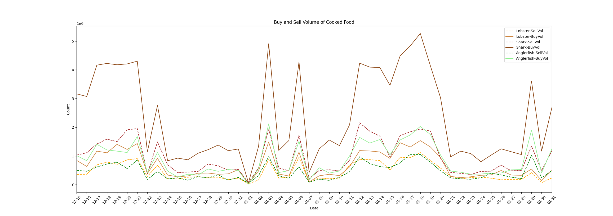

The graph above reveals two notable patterns. First, buy volumes are generally higher than sell volumes. This makes sense, as players use food across a wide range of activities and likely consume more than they sell. However, these data only show that more food is bought than sold; players may still hold large quantities of food in their banks. Second, both buy and sell volumes show noticeable spikes on January 3 and January 6. These spikes provide evidence of changes in market activity that could potentially be related to the rolling blackouts in Venezuela following the reported bombing of its power grid.

As a point of comparison, we observe a similar pattern when examining the buy and sell volumes of raw food, as shown below.

```Python

ax=raw_lobsterdf.plot('timestamp','sell_volume',label='raw-lobster-SellVol',color='orange',xlim=('2025-12-15','2026-01-31'),linestyle='--')
raw_lobsterdf.plot('timestamp','buy_volume',label='raw-lobster-BuyVol',color ='peru',ax=ax,linestyle='-')

raw_sharkdf.plot('timestamp','sell_volume',label = 'raw-shark-SellVol',color='sandybrown',ax=ax,linestyle='--')
raw_sharkdf.plot('timestamp','buy_volume',label='raw-shark-BuyVol',color = 'saddlebrown',ax=ax,linestyle='-')

raw_anglerfishdf.plot('timestamp','sell_volume',label= 'raw-anglerfish-SellVol',color='green',ax=ax,linestyle='--')
raw_anglerfishdf.plot('timestamp','buy_volume',label='raw-anglerfish-BuyVol',color = 'lightgreen',ax=ax,linestyle='-')

ax.xaxis.set_major_locator(mdates.DayLocator()) # Label every day
ax.xaxis.set_major_formatter(mdates.DateFormatter('%m-%d')) # Format as Dec 01, Dec 02, or 12-01,12-02 ...
plt.xticks(rotation=45)
plt.xlabel('Date')
plt.ylabel('Count')
plt.title('Buy and Sell Volume of Raw Food')
```


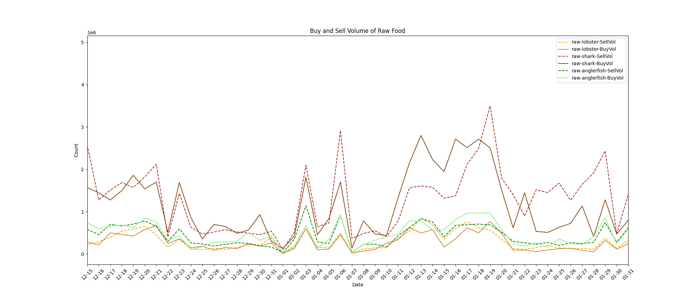

Interestingly, when we examine raw food, we observe similar spikes on the same dates mentioned above. However, sell volumes exceed buy volumes for raw sharks and anglerfish. One possible explanation is that players noticed changes in the market value of these items and began selling them in large quantities. It is worth noting, however, that buy and sell volumes remain within the same order of magnitude, so the differences are not extreme.

Another notable observation from the raw-food buy and sell volume graph is that, despite changes in trading volumes around January 3, the prices and price margins of these items remained relatively stable. Compared with cooked food, raw-food buy and sell volumes also appear to be more stable.

The plot below shows the buy and sell prices of cooked food, which follow trends similar to those observed for raw food. However, unlike trading volumes, prices do not show a clear spike around January 3.

```Python
ax=lobsterdf.plot('timestamp','avg_sell_price',label='lobster-SellPrice',color='orange',xlim=('2025-12-15','2026-01-31'),linestyle='--')
lobsterdf.plot('timestamp','avg_buy_price',label='lobster-BuyPrice',color ='peru',ax=ax,linestyle='-')

sharkdf.plot('timestamp','avg_sell_price',label = 'shark-SellPrice',color='sandybrown',ax=ax,linestyle='--')
sharkdf.plot('timestamp','avg_buy_price',label='shark-BuyPrice',color = 'saddlebrown',ax=ax,linestyle='-')

anglerfishdf.plot('timestamp','avg_sell_price',label= 'anglerfish-SellPrice',color='green',ax=ax,linestyle='--')
anglerfishdf.plot('timestamp','avg_buy_price',label='anglerfish-BuyPrice',color = 'lightgreen',ax=ax,linestyle='-')

ax.xaxis.set_major_locator(mdates.DayLocator()) # Label every day
ax.xaxis.set_major_formatter(mdates.DateFormatter('%m-%d')) # Format as Dec 01, Dec 02, or 12-01,12-02 ...
plt.xticks(rotation=45)
plt.xticks(rotation=45)
plt.xlabel('Date')
plt.ylabel('Count')
plt.title('Buy and Sell Price of Cooked Food')

```


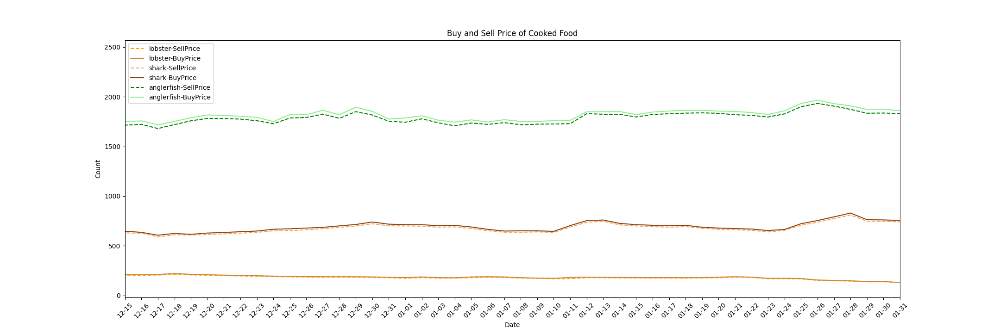


### Step 2: Buy Volume Two-Way Anova

Now that we have confirmed the structure of our dataframe and examined trends in the data, we can proceed with our statistical analysis. We begin by performing a two-way ANOVA on the buy volumes of cooked food, comparing the week before January 3, 2026, with the week beginning January 3, 2026, including January 3 in the latter period.

Our two independent variables are **period** (before vs. after January 3rd) and **food type** (sharks, lobsters, and anglerfish). Our dependent variable is **buy volume**, as we are interested in how purchasing activity changed between the two periods.

The two-way ANOVA allows us to examine two main effects and the interaction between them. The first main effect tests whether average buy volume across all three food types differs between the week before January 3 and the week beginning January 3. The second main effect tests whether average buy volume differs among sharks, lobsters, and anglerfish, regardless of the period. Finally, the interaction effect tests whether the change in average buy volume between the two periods differs by food type. For example, did the buy volume of sharks increase more than that of lobsters? This interaction helps us determine whether the change in buy volume around January 3 varied among the three foods.

We begin the two-way ANOVA by creating an event window containing only the data within our selected date range.

```Python 
food_df = pd.concat([lobsterdf,sharkdf,anglerfishdf],axis=0,ignore_index=True)
food_df['timestamp'] = pd.to_datetime(food_df['timestamp'])
event_date = pd.Timestamp("2026-01-03")
event_window = food_df[
    (food_df['timestamp'] >= event_date - pd.Timedelta(days=7)) &
    (food_df['timestamp'] <= event_date + pd.Timedelta(days=6))].copy()

event_window['period'] = 'After'
event_window.loc[event_window['timestamp'] < event_date,'period'] = 'Before'

event_window.head()
```

|   index |   item_id | item_name   | timestamp           |   avg_buy_price |   avg_sell_price |   buy_volume |   sell_volume |   days | period   |
|--------:|----------:|:------------|:--------------------|----------------:|-----------------:|-------------:|--------------:|-------:|:---------|
|     546 |       379 | Lobster     | 2025-12-27 00:00:00 |             188 |              183 |       398827 |        276886 |    182 | Before   |
|     547 |       379 | Lobster     | 2025-12-28 00:00:00 |             188 |              183 |       404470 |        257661 |    183 | Before   |
|     548 |       379 | Lobster     | 2025-12-29 00:00:00 |             188 |              183 |       362695 |        261775 |    184 | Before   |
|     549 |       379 | Lobster     | 2025-12-30 00:00:00 |             186 |              181 |       376831 |        179768 |    185 | Before   |
|     550 |       379 | Lobster     | 2025-12-31 00:00:00 |             183 |              177 |       524085 |        227959 |    186 | Before   |


we follow up by showing a quick summary of our new event window to get an idea of the data and trends

```Python
summary = (
    event_window
    .groupby(["item_name", "period"])["buy_volume"]
    .agg(
        Count="count",
        Mean="mean",
        Std="std",
        Median="median",
        Q1=lambda x: x.quantile(0.25),
        Q3=lambda x: x.quantile(0.75),
        Min="min",
        Max="max"
    )
    .round(0)
)
summary=summary.reset_index()
print(summary)
```

| item_name   | period   |   Count |             Mean |              Std |           Median |               Q1 |               Q3 |    Min |     Max |
|:------------|:---------|--------:|-----------------:|-----------------:|-----------------:|-----------------:|-----------------:|-------:|--------:|
| Anglerfish  | After    |       7 | 814703           | 716694           | 487263           | 413809           |      1.05044e+06 | 169272 | 2117893 |
| Anglerfish  | Before   |       7 | 421603           | 192858           | 498137           | 399770           | 536972           |  19520 |  560080 |
| Lobster     | After    |       7 | 579728           | 516580           | 361187           | 306128           | 750106           |  97507 | 1486936 |
| Lobster     | Before   |       7 | 367885           | 160591           | 398827           | 369763           | 442258           |  28245 |  524085 |
| Shark       | After    |       7 |      2.16331e+06 |      1.71024e+06 |      1.53879e+06 |      1.21978e+06 |      2.91497e+06 | 427574 | 4907279 |
| Shark       | Before   |       7 |      1.07414e+06 | 454605           |      1.21805e+06 |      1.13876e+06 |      1.28902e+06 |  65808 | 1379553 |


To identify potential outliers in our data, we created boxplots comparing food buy volumes before and after the event.

```Python
fig,ax = plt.subplots(figsize=(8,6))
event_window.boxplot(
    column='buy_volume',
    by=['item_name','period'],
    ax=ax
)
plt.title("Buy Volume by Item and Period")
plt.suptitle("")  # Removes the automatic pandas title
plt.xlabel("Item and Period")
plt.ylabel("Buy Volume")
plt.xticks(rotation=45)


```


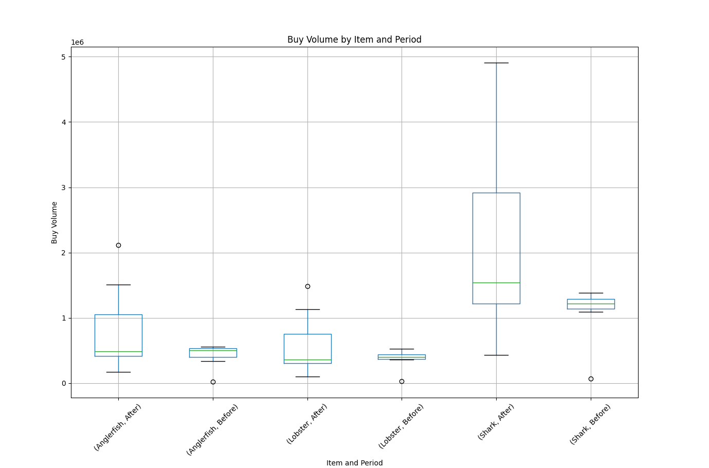

The boxplot above compares buy volumes for each food type before and after the event. The green line represents the median for each group, while the whiskers extend to the most extreme data points within 1.5 times the interquartile range (IQR) of the lower and upper quartiles. Data points beyond the whiskers are considered potential outliers, which must be interpreted in the context of the study. In this analysis, we chose to retain these outliers because our dataset is relatively small and these observations may be relevant to our research question.

After examining potential outliers in our dataframe, we investigated whether there might be an interaction between food type and period before conducting the ANOVA. To do this, we plotted the average buy volume for each food type before and after January 3, as shown below. The lines appear roughly parallel, suggesting that the change in buy volume may be similar across the three food types and that the interaction effect may be small. However, this visual assessment is only preliminary; the two-way ANOVA will allow us to formally test whether the interaction is statistically significant.

```Python
# Plotting the interaction means for the three types of food before and after the period.

means = (
    event_window
    .groupby(['period', 'item_name'])['buy_volume']
    .mean()
    .unstack()
)

# Put Before first
means = means.reindex(['Before', 'After'])
means.head()
print(means)

ax = means.plot(
    marker='o',
    linewidth=2
)

print(ax.get_xticks())
print(ax.get_xticklabels())

ax.set_xticks([0, 1])
ax.set_xticklabels(['Before', 'After'])

plt.title("Mean Buy Volume Before and After January 3, 2026")
plt.xlabel("Period")
plt.ylabel("Mean Buy Volume")
plt.grid(True)
plt.show()
```


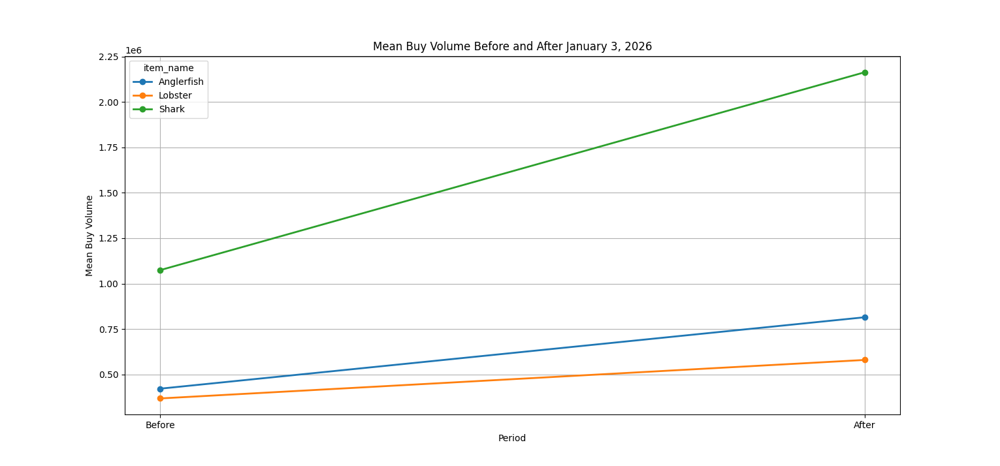

Finally, we can analyze our data using a two-way ANOVA. First, we fit an ordinary least squares (OLS) regression model using the `statsmodels` library. We then use this model to perform the ANOVA and evaluate the effects of period, food type, and their interaction on buy volume, as shown below.

```Python
#ordinary least squares model that fits a linear regressio model
model_buyvol = ols('buy_volume ~ C(period) * C(item_name)',data=event_window).fit()

twoway_anova_buyvol = sm.stats.anova_lm(model,type=2)
print(twoway_anova_buyvol)
```

|                        |   df |      sum_sq |     mean_sq |         F |      PR(>F) |
|:-----------------------|-----:|------------:|------------:|----------:|------------:|
| C(period)              |    1 | 3.34835e+12 | 3.34835e+12 |   5.05404 |   0.0307865 |
| C(item_name)           |    2 | 1.08864e+13 | 5.4432e+12  |   8.21603 |   0.00115   |
| C(period):C(item_name) |    2 | 1.50158e+12 | 7.50789e+11 |   1.13325 |   0.333202  |
| Residual               |   36 | 2.38504e+13 | 6.6251e+11  | nan       | nan         |

Our results provide several important insights. First, the main effect of period is statistically significant, as the p-value is below 0.05. This indicates that there is a statistically significant difference in average buy volume between the week before January 3 and the week beginning January 3. Second, the main effect of item type is also statistically significant, indicating that average buy volume differs among sharks, lobsters, and anglerfish, regardless of the period. This is expected, as these foods serve different purposes in the game and may have different levels of demand. However, this finding is not directly relevant to our primary research question. Finally, the interaction between period and item type is not statistically significant, as its p-value is greater than 0.05. In simpler terms, we do not have sufficient statistical evidence to conclude that the change in average buy volume between the two periods differed among sharks, lobsters, and anglerfish. Although the magnitude or direction of change may vary between items, the differences in those changes were not statistically significant.

To assess whether our model satisfies the assumptions of the ANOVA, we next examined the residuals for normality and equal variance. We began by comparing the mean and median of the model residuals to look for potential skewness. Although this comparison alone cannot establish whether the residuals are normally distributed, a median greater than the mean may suggest left skewness. This could be influenced by the outlier identified earlier, so we proceeded with additional statistical tests to assess normality more rigorously.

```Python
print(model_buyvol.resid.describe())
```

|       |                 0 |
|:------|------------------:|
| count |      42           |
| mean  |       2.82723e-10 |
| std   |  762703           |
| min   |      -1.73573e+06 |
| 25%   | -378570           |
| 50%   |   13713.4         |
| 75%   |  142556           |
| max   |       2.74397e+06 |


To further assess normality, we performed the Shapiro–Wilk test. The W statistic measures how closely our data follows a normal distribution, with values closer to 1 generally indicating greater consistency with normality. Our results show a p-value below the significance level of \(\alpha = 0.05\), providing statistically significant evidence that the model residuals deviate from a normal distribution. To further investigate this deviation, we created a Q–Q plot to visually compare the distribution of our residuals with a theoretical normal distribution.

```Python
W_stat,W_p = scipy.stats.shapiro(residuals)
print("Shapiro-Wilk test statistic: ",W_stat,"P-value: ",W_p)


#qq_plot
scipy.stats.probplot(residuals,dist="norm",plot=plt)
plt.title("Buy Volume QQ-Plot of ANOVA Residuals")
plt.show()

```

Shapiro-Wilk test statistic:  0.8652018825164721 P-value:  0.00015274031329211263

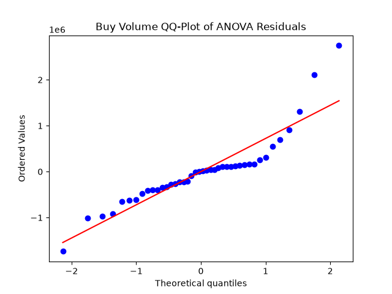

The Q–Q plot above suggests that our residuals deviate from a normal distribution, particularly in the right tail, where the points diverge from the reference line. However, the Q–Q plot alone makes it difficult to determine the direction and extent of any skewness. To further investigate the distribution of our residuals and assess the apparent deviation from normality, we examined a histogram.

```Python
#histogram
plt.hist(residuals,bins=10)
plt.xlabel("Residuals")
plt.ylabel("Frequency")
plt.title("Buy Volume Distribution of ANOVA Residuals")
plt.show()
```

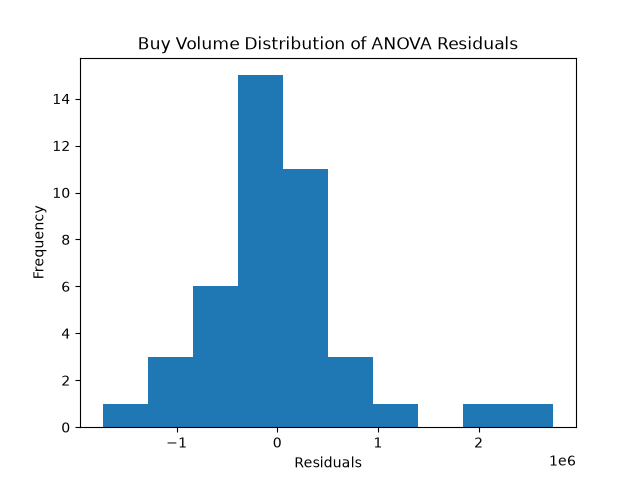


The histogram suggests that our residuals may be left-skewed, although the outlier near 2 appears to influence the distribution. This visual evidence is consistent with the results of the Shapiro–Wilk test and Q–Q plot, which both suggest deviations from normality. However, we must be cautious when interpreting these results for two reasons. First, our sample size is relatively small, consisting of seven days before and seven days after January 3, with one observation for each food type per day. With so few observations, it is difficult to reliably characterize the underlying distribution. Second, our data were collected during an unusual period of Grand Exchange activity, with significant spikes in trading volume. These observations may represent genuine market behavior relevant to our research question. Therefore, rather than removing these observations solely to improve normality, we retained them and proceeded with the ANOVA, acknowledging that the normality assumption may not be fully satisfied. This limitation should be considered when interpreting our results.

After examining normality, we assessed the assumption of equal variance using Levene’s test. In a two-way ANOVA, this assumption means that the residual variance is approximately equal across the groups being compared, including the combinations of food type and period. Because the boxplots alone did not clearly establish whether the variances were similar, we used Levene’s test for a more formal assessment. The test produced a p-value greater than our significance level of \(\alpha = 0.05\). Therefore, we fail to reject the null hypothesis of equal variances. This means that we did not find statistically significant evidence of unequal variances, although it does not prove that the variances are identical.

```Python
l_stat, l_p = scipy.stats.levene(
    event_window.loc[event_window.item_name == "Shark","buy_volume"],
    event_window.loc[event_window.item_name == "Lobster","buy_volume"],
    event_window.loc[event_window.item_name == "Anglerfish",'buy_volume']
)
print("Levene statistic: ",l_stat,"P-value: ",l_p) #p value is >.05 meaning variances are not significantly different so the anova is okay

```
Levene statistic:  1.6891638211624205 P-value:  0.19790440340896562


In conclusion, our two-way ANOVA provided several important insights into cooked-food buy volumes. Our primary objective was to determine whether average buy volume differed between the week before January 3 and the week beginning January 3 for sharks, lobsters, and anglerfish. Our results showed a statistically significant difference in average buy volume between the two periods. Additionally, the interaction effect was not statistically significant, suggesting that the change in buy volume was not significantly different among the three food types.

We then assessed the ANOVA assumptions of normality and equal variance. Levene’s test did not provide statistically significant evidence of unequal variances. However, the Shapiro–Wilk test, Q–Q plot, and histogram suggested that our residuals deviated from normality. Therefore, we cannot confidently conclude that the normality assumption was satisfied, and this limitation should be considered when interpreting our results. This concludes our analysis of cooked-food buy volumes. Next, we will investigate whether player population counts differed before and after January 3.

### Step 3: Analyzsis of Player Population

We began our OSRS player population analysis by retrieving player count data from the OSRS Player Count website using its API. We then divided the data into the same one-week periods before and after January 3 used in our previous analysis. Unlike our Grand Exchange dataset, which recorded observations daily, the player count dataset records observations hourly, providing a larger number of observations for our analysis. The code below shows how we separated the data into these two periods.

```Python

player_numbers = pd.read_sql(
    """
    select *,date(timestamp) as `date`
    from player_count
    where timestamp between ('2026-01-03' -interval 7 day) and ('2026-01-03' + interval 6 day)
    """,conn
)

player_numbers
#plt.scatter(player_numbers['timestamp'],player_numbers['player_count'])

ax = player_numbers.plot(
    'timestamp', 'player_count',
    style='--',
    ylim=(100000, 260000),
    title='OSRS Player Population Over Time',
    xlabel='Date',
    ylabel='Player Count'
)

ax.xaxis.set_major_locator(mdates.HourLocator(byhour=0, interval=24))
ax.xaxis.set_major_formatter(mdates.DateFormatter('%Y-%m-%d'))

plt.show()

prior_date = pd.read_sql(
    """
    select *,date(timestamp) as `date`
    from player_count
    WHERE timestamp between '2026-01-03' - interval 7 day and '2026-01-02 23:59:59'
    """,conn
)

prior_date

after_date = pd.read_sql(
    """
    select *,date(timestamp) as `date`
    from player_count
    where timestamp between '2026-01-03' and '2026-01-03' + interval 6 day
    """,conn
)

after_date
```

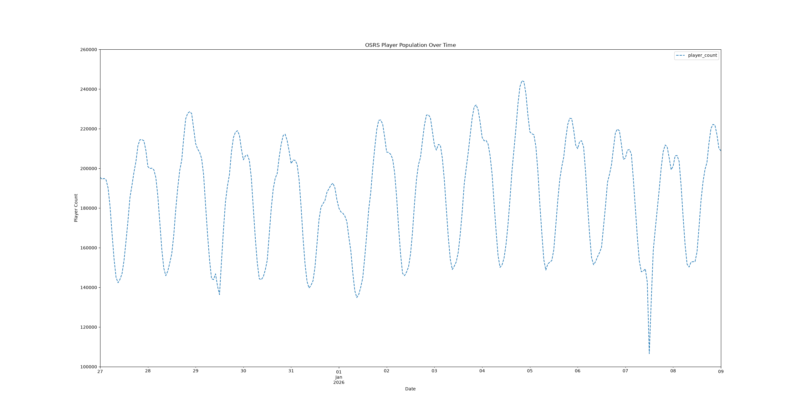

Based on the player population graph, there does not appear to be a noticeable difference in player counts before and after January 3, despite the changes in Grand Exchange food buy volumes. To investigate this further, we used an independent-samples t-test and a Mann–Whitney U test to determine whether player population differed between the two periods.

Before conducting these tests, we first examined the **normality** of the player population data. Normality is an assumption of the independent-samples t-test, whereas the Mann–Whitney U test does not require the data to follow a normal distribution. Because our player population dataset contains hourly observations, our sample size is greater than 50 in each period. We therefore began by examining histograms and QQ-plots to visually assess the distributions. We also performed the Shapiro–Wilk test to supplement our visual assessment. Although the Shapiro–Wilk test can be used with larger samples, it may detect even small deviations from normality when the sample size is large. By using both visual and statistical assessments, we could better determine whether the data deviated from a normal distribution and whether the Mann–Whitney U test would provide a useful alternative to the t-test.

After examining normality, we assessed the **equal-variance assumption** for the independent-samples t-test. This assumption requires the player counts in the two periods to have approximately equal variances. The following sections present our normality assessments first, followed by our test for equal variance.

```Python
tl_stat,tl_pvalue = scipy.stats.levene(prior_date.player_count,after_date.player_count)
print(f'Levene test = {tl_stat:.4f}, P-value = {tl_pvalue:.4f}')
alpha =.05
if tl_pvalue < alpha:
    print("Reject the null hypothesis: Variances are NOT equal.")
else:
    print("Fail to reject the null hypothesis: Variances ARE equal.")

#normality check here
    
print(f"Before: W statistic = {W_before:.3f}, P-value = {W_before_pvalue:.4f}")
print(f"After : W statistic= {W_after:.3f}, P-value = {W_after_pvalue:.4f}")

scipy.stats.probplot(prior_date.player_count,dist='norm',plot=plt)
plt.title("Q-Q Plot: Player Population Before Jan. 3")

scipy.stats.probplot(after_date.player_count,dist='norm',plot=plt)
plt.title("Q-Q Plot: Player Population After Jan. 3")


plt.hist(prior_date.player_count,bins=20)
plt.title("Player Population Distribution Before Jan. 3")
plt.xlabel("Player Population")
plt.ylabel("Frequency")


plt.hist(after_date.player_count,bins=20)
plt.title("Player Population Distribution After Jan. 3")
plt.xlabel("Player Population")
plt.ylabel("Frequency")

```
Levene’s test indicated that we did not find statistically significant evidence of unequal variances between our two groups. We then performed the Shapiro–Wilk test to assess the normality of the player population data. Both the before and after groups returned p-values that rounded to 0.0000, indicating statistically significant evidence that the data in both groups deviate from a normal distribution.

Because our sample sizes exceed 50 in both groups, we also examined Q–Q plots to visually assess normality. The Q–Q plot for the period before January 3 shows deviations from the reference line, suggesting that the data do not follow a normal distribution. To further investigate these deviations, we examined histograms of the player population data for both periods. The histograms, along with the Shapiro–Wilk test and Q–Q plots, suggest that neither group is normally distributed.

Given these results, we decided to use the Mann–Whitney U test as an alternative to the independent-samples t-test. Although the t-test can be robust to moderate deviations from normality, the Mann–Whitney U test does not require normally distributed data. Our Mann–Whitney U test returned a p-value of 0.01368, which is below our significance level of \(\alpha = 0.05\). Therefore, we reject the null hypothesis and conclude that there is a statistically significant difference in player population between the periods before and after January 3.

It is important to note that the Mann–Whitney U test compares the distributions of the two groups; it does not necessarily test for a difference in their means. Additionally, because our observations were recorded hourly, consecutive player counts may be correlated, which could affect the validity of the test’s results.

Levene test statistic = 0.2307, P-value = 0.6314


Before: Shapiro-Wilk W statistic = 0.942, P-value = 0.0000
After : Shapiro-Wilk W statistic = 0.940, P-value = 0.0000

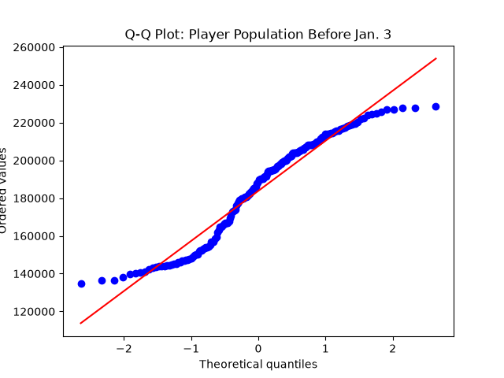

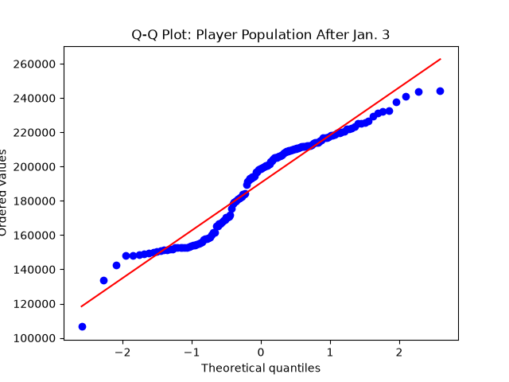

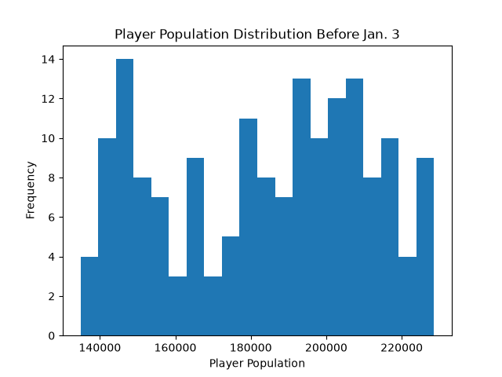
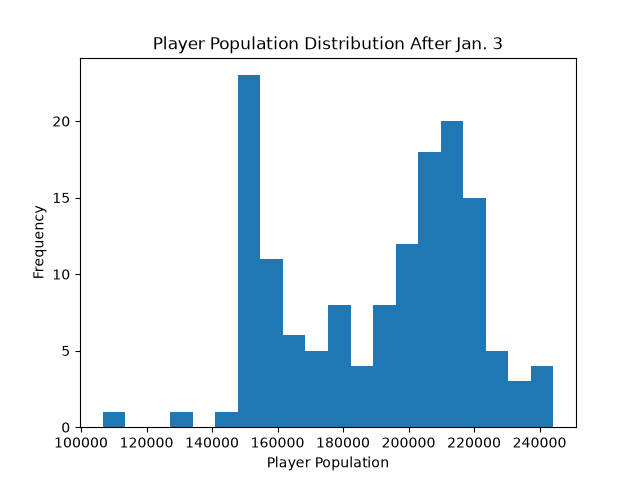

```Python

MWU_stat, MWU_pvalue = scipy.stats.mannwhitneyu(prior_date.player_count,after_date.player_count,alternative='two-sided')

print(f"MWU_statistic = {MWU_stat}, MWU_P-value = {MWU_pvalue}")
```
MWU_statistic = 10211.0, MWU_P-value = 0.013678399414026276

### Step 4: Analysis Conclusion
## Conclusion

After analyzing our results, we can draw several conclusions and consider a possible explanation for the changes in OSRS market activity and player population around January 3, 2026. First, our two-way ANOVA examined the buy volumes of three popular food items: sharks, anglerfish, and lobsters. The results showed a statistically significant difference in average buy volume between the week before January 3 and the week beginning January 3. Additionally, our Mann–Whitney U test found a statistically significant difference in player population between the two periods, with a p-value of 0.01368. Taken together, these results indicate that both Grand Exchange trading activity for these food items and player population changed significantly around the same time as the reported rolling blackouts in Venezuela.

It is possible that these changes were caused by reduced access to OSRS for players in Venezuela, as our initial hypothesis suggested. However, we must also consider other possible explanations. In the United States, this period falls between Christmas and the return to work and school after the New Year. It is possible that this seasonal change affected player activity, with people selling food or adjusting their inventories in anticipation of having less time to play. In our opinion, this is less likely, as the player population appeared relatively stable before and after the period we examined. Additionally, we did not identify any other global events or server-related issues that would explain the decrease in player population during this time.

Based on these findings, we believe it is possible that the reported disruptions in Venezuela contributed to the observed changes in OSRS player population and Grand Exchange activity. If a significant number of players in Venezuela lost access to the game, this could explain the decrease in player population. Furthermore, if some of the accounts that disappeared were bots, this could also explain the changes in trading volumes for commonly traded food items.

As such, our results raise the possibility that Venezuelan players make up a significant portion of the OSRS player population and that bots may account for a portion of those players. However, our analysis cannot directly establish the geographic location of affected players or determine how many of them were bots. Further investigation would be needed to confirm this hypothesis and distinguish the effects of regional disruptions from other factors that may have influenced player activity during this period.


<br>
<br>
<br>
<br>
<br>
<br>
<br>
<br>
<br>
<br>
<br>
<br>


